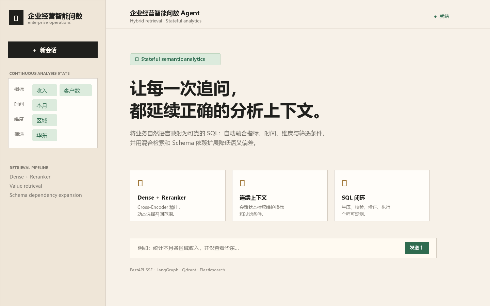

# 企业经营智能问数 Agent

面向企业经营分析的语义数据 Agent。用户可以直接用自然语言询问指标、趋势、分组、筛选和排名；服务会将问题解析为可继承的分析意图，经多路 Schema 检索和依赖扩展后生成受约束的只读 SQL，并通过 SSE 持续返回过程与结果。

它解决的是“经营事实是什么”的问题，例如“近 30 天各区域收入前五名”“华北替换为华南后利润率如何变化”。对于“为什么下降、应该采取什么行动”一类需要跨源证据与归因的任务，应交给上游的经营决策系统处理。



## 核心能力

- **连续上下文问数**：`StructuredQueryState` 显式保存指标、时间、维度、筛选、排序与 Top-N；后续追问先补全完整分析意图，再进入检索链路。
- **Dense Retrieval + Reranker**：Qdrant 负责语义候选召回，Cross-Encoder Reranker 负责精排，动态 Top-K 控制上下文规模。
- **Elasticsearch Value Retrieval**：检索真实字段值，辅助解析区域、客户类型、渠道等筛选条件。
- **Schema Dependency Expansion**：自动补齐指标依赖字段、时间字段和 Join Key。
- **受限 SQL 闭环**：仅允许单条 `SELECT`/`WITH` 查询；生成后预检查，最多一次修正后再次检查；执行层有超时和 1000 行上限。
- **可观察执行**：SSE 推送检索、生成、校验、修正与执行状态。

## 运行示例

```text
用户：近 30 天华东区域各业务单元收入前 10 名
用户：改成华北，只看前 5 名

系统继承：近 30 天、收入、业务单元
系统替换：区域 = 华北、Top-N = 5
```

前端会展示已识别的指标、时间范围、维度、过滤条件、排序和 Top-N，以及 Schema 检索、SQL 校验与执行状态。示例元数据采用本地零售数仓，便于开箱运行；状态管理、检索编排与安全链路均与特定行业解耦。

## 系统架构

```text
React Console
    │ question + session_id
    ▼
FastAPI · POST /api/query · SSE
    │
    ├── Short-term Memory + StructuredQueryState
    │       └── 继承 / 替换 / 清除条件，生成完整分析意图
    │
    ├── Query Expansion
    │       ├── Qdrant Dense Schema Retrieval
    │       ├── Elasticsearch Value Retrieval
    │       └── Cross-Encoder Reranker + Dynamic Top-K
    │
    ├── Schema Dependency Expansion
    │       └── 指标依赖字段 · 时间字段 · Join Key
    │
    └── Safe SQL Loop
            Generate → Validate / EXPLAIN → Correct once → Validate → Read-only Execute
```

## 连续问数如何工作

每个 `session_id` 对应一份短期会话状态。状态更新不是简单拼接字符串，而是对分析要素执行三类动作：

| 用户表达 | 状态动作 | 示例 |
| --- | --- | --- |
| “近 30 天华东收入” | 继承 / 新增 | 时间 = 近 30 天，区域 = 华东，指标 = 收入 |
| “改成华北” | 替换 | 区域从华东替换为华北 |
| “不看渠道” | 清除 | 移除渠道维度或筛选 |
| “收入最低的前五名” | 独立解析排序与 Top-N | 收入升序，`limit = 5` |

生成 SQL 和 SQL 修正节点会获得同一份结构化状态与会话摘要。字段、指标和过滤检索也使用补全后的 `analysis_query`，避免上下文只在 SQL 生成阶段才生效。

## 检索与 Schema 扩展

```text
自然语言问题
    ↓ Query Expansion
Dense Schema Candidates ──┐
                           ├── Cross-Encoder Reranker ──> Dynamic Top-K
Value Candidates (ES) ─────┘
                                             ↓
          Dependency Expansion：指标字段 + 时间字段 + Join Key
                                             ↓
                                 SQL Prompt 的受控 Schema 上下文
```

- **Dense 检索**使用 Qdrant 与 embedding 服务，在表、字段和指标描述中召回语义候选。
- **Value 检索**使用 Elasticsearch 中的字段值索引，帮助将“华北”“重点客户”等文本映射到可用的筛选值。
- **Reranker**调用 `BAAI/bge-reranker-v2-m3` 兼容服务，对候选按问题相关性重新排序；它不负责生成 SQL。
- **依赖扩展**将指标口径涉及的字段、时间约束和关联键补入候选 Schema，确保聚合、分组与关联所需结构可以同时进入提示词。

## Evaluation

评测设置与可复现口径见 [docs/evaluation.md](docs/evaluation.md)。在 BIRD Mini-Dev 的 500 条样本上，执行准确率从 Raw Schema baseline 的 **57.4%** 提升至 Schema RAG 的 **74.2%**，加入一次受限 Self-Correction 后为 **77.0%**；Schema Recall@5 为 **93.6%**。

## Demo

- 统计本月各区域收入与客户数，并按收入从高到低排序。
- 为什么某区域业务量增长，但利润率下降？
- 分析本月客户流失率明显上升的可能原因，并列出待验证指标。

示例元数据使用零售样例数仓，目的是便于本地启动；核心检索、状态管理和 SQL 安全链路不依赖特定行业。

## Quick Start

需要 Python 3.14+、[uv](https://docs.astral.sh/uv/)、Node 22+、pnpm 10+ 和 Docker。

```bash
copy .env.example .env
docker compose -f docker/docker-compose.yaml up -d
uv sync
uv run python app/scripts/build_meta_knowledge.py
uv run fastapi dev main.py
```

另开一个终端启动前端：

```bash
pnpm --dir frontend install
pnpm --dir frontend dev
```

在 `.env` 配置 `LLM_API_KEY` 后访问 `http://localhost:5173`。首次启动还需准备 `BAAI/bge-reranker-v2-m3` 模型文件，Reranker 服务默认运行在 `http://localhost:8082/rerank`。

默认本地服务如下：

| Service | Default address | Responsibility |
| --- | --- | --- |
| FastAPI | `http://localhost:8000` | 问数 API 与 SSE |
| Frontend | `http://localhost:5173` | 可视化问数界面 |
| MySQL | `localhost:3306` | 示例元数据与数仓 |
| Qdrant | `http://localhost:6333` | Schema 向量召回 |
| Elasticsearch | `http://localhost:9200` | 字段值检索 |
| Embedding | `http://localhost:8081` | 向量生成 |
| Reranker | `http://localhost:8082/rerank` | 候选精排 |

## Safety

模型提示“只生成查询”不足以构成权限边界，因此本项目在执行前增加程序级限制：

1. 使用 `sqlglot` 解析 SQL，只允许单条查询语句与 `WITH` 查询。
2. 拒绝 `INSERT`、`UPDATE`、`DELETE`、`DROP`、`ALTER`、`CREATE` 等写操作及多语句。
3. 拒绝 `INTO OUTFILE`、`LOAD_FILE` 等文件访问表达式。
4. 先 `EXPLAIN` 预检查；若失败，带着原始分析上下文进行一次有限修正并重新检查。
5. 通过独立只读账户执行，限制执行时长和最大返回行数。

Docker 示例数仓账户仅被授予 `SELECT`；已有数据卷需要管理员撤销旧写权限后重新授权。`EXPLAIN` 只用于前置验证，不能替代最小权限数据库账户；生产环境应按实际表范围授予最小 `SELECT` 权限。

## API 合约

### `POST /api/query`

请求体：

```json
{
  "query": "查询近 30 天华北区域收入最低的前五个业务单元",
  "session_id": "demo-session-001"
}
```

响应为 `text/event-stream`。SSE 会依次返回检索与执行节点事件，最终包含查询结果或错误信息。接口详情可在服务启动后访问 `http://localhost:8000/docs`。

```bash
curl -N -X POST http://localhost:8000/api/query \
  -H "Content-Type: application/json" \
  -d '{"query":"统计本月各区域收入与客户数，并按收入降序排列","session_id":"demo-session-001"}'
```

## Project Structure

```text
app/
  agent/           # LangGraph 工作流、检索和 SQL 节点
  api/             # FastAPI 路由、请求模型、生命周期
  clients/         # MySQL、Qdrant、ES、Embedding、Reranker 客户端
  repositories/    # Schema 与字段值数据访问
  services/        # 会话状态、查询服务、元数据服务
  scripts/         # 元数据构建与文档预览生成
conf/              # 运行配置与样例 Schema 元数据
docker/            # 本地 MySQL、ES、Qdrant、模型服务编排
frontend/          # React + TypeScript SSE 控制台
docs/              # 评测口径、静态页面与预览图片
tests/             # 会话状态回归测试
```

## 配置与适配

- 环境变量模板见 [.env.example](.env.example)，至少需要配置 `LLM_API_KEY`。
- 服务地址、模型名、超时和向量维度见 [conf/app_config.yaml](conf/app_config.yaml)。
- 表、字段、指标定义与依赖关系见 [conf/meta_config.yaml](conf/meta_config.yaml)。替换此文件和对应数据源，可为制造、SaaS、金融服务或其他经营场景配置新的 Schema。
- 本地示例仅使用演示数据；不要将生产数据库密码、真实客户信息或模型密钥提交到仓库。

## 开发检查

```bash
uv run ruff check .
python -m unittest discover -s tests -v
pnpm --dir frontend build
```

## 能力边界与后续扩展

- 当前核心目标是受控的单轮 / 多轮事实型查询，不输出未经证据验证的经营归因或行动建议。
- 当前检索面向结构化 Schema 和字段值；复杂文档解析、OCR 和大规模向量索引不属于此仓库的默认能力。
- 可以扩展会话级知识索引、查询审计存储、语义缓存、指标口径版本管理与更细粒度的行列权限控制。

## Acknowledgements

本项目的早期智能问数工程原型参考了 [AI Agents From Zero](https://didilili.github.io/ai-agents-from-zero)。本项目已围绕企业经营分析场景，独立重构了产品定位、会话状态管理、检索精排、Schema 依赖扩展、SQL 安全闭环与交互文案。

## License

MIT，详见 [LICENSE](LICENSE)。
